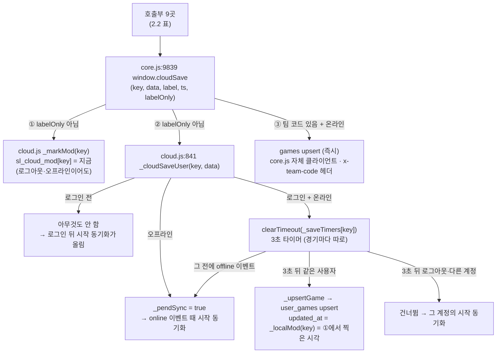

# 후속 11번 — `cloudSave` 덮어쓰기로 `user_games` 즉시 업로드가 죽어 있던 문제

> 설계 문서. 앱 코드(index.html · js/ · css/)는 바꾸지 않는다.
> 기준: `main` 8f13621 (2026-10-17) · `cloud.js?v=32` · `core.js?v=225` · `app.js?v=119`

## 0. 결론 먼저

- **11번은 이미 고쳐져 있다.** PR #97 (2026-10-11 머지, 그때 `cloud.js?v=22` · `core.js?v=137`)이 아래 3절의 **방향 B(디스패처)** 로 고쳤다. 다만 #97 본문에 "후속 11번" 번호가 붙지 않아서, PR 본문으로 이어 온 후속 목록에는 11번이 계속 미착수로 남아 있었다.
- 오늘 `main` 에서 코드를 다시 따라가 보고 테스트를 돌려 확인했다.
  - `node tests/run.mjs zz-cloud-save user-games sync.test` → **36 통과 / 0 실패**. 외부 요청은 0건이다.
  - 변이 검사: `core.js` 래퍼에서 `_cloudSaveUser` 를 부르는 한 줄을 빼면 `zz-cloud-save.test.js` 3개가 **모두 실패**한다(기대 1 → 실제 0, [1,1] → [0,0], [7] → []). 확인한 뒤 되돌렸고 커밋하지 않았다. 11번이 다시 생기면 이 테스트가 잡는다.
- **추천: B 를 그대로 둔다.** 다시 손댈 코드는 없다. 이 문서로 11번을 닫는다. 11번을 다시 보다가 찾은 틈은 4절에 12·13번 후보로 적었고, 둘 다 테스트로 재현한 뒤에 설계한다.

## 1. 문제 (PR #69 에 적었던 내용)

`cloud.js` 와 `core.js` 가 같은 전역 이름 `window.cloudSave` 를 정의한다.

- `cloud.js` 는 `<head>` 의 일반 스크립트라 먼저 실행된다. 이 파일의 `cloudSave` 는 3초 디바운스 뒤 `user_games` 에 올린다.
- `core.js` 는 `defer` 라 나중에 실행된다. 이 파일의 `cloudSave` 는 팀 코드 `games` 테이블에 올리는데, 앞의 정의를 덮어쓰기만 하고 부르지는 않았다.

그래서 로그인 사용자가 저장·가져오기·타석 수정을 해도 그 경기는 **다음 시작 동기화 때에야** `user_games` 에 올라갔다. 그 사이 실시간으로 올라간 것은 자동저장 키 `sl_auto_*`(`cloudAutoSyncRecord`)뿐이다. PR #69 때 "로그인 후 저장하고 5초 기다려도 요청 0건"으로 확인했다.

#97 이 같이 고친 문제가 두 개 더 있다.
- 저장 업로드와 타구 기록 실시간 동기화가 3초 타이머(`_debTimer`) 하나를 같이 썼다. 그래서 위 문제를 고치면, 저장 직후 3초 안에 타구를 기록할 때 저장한 경기의 업로드가 취소된다.
- 업로드를 기다리는 중에 오프라인이 되면 그 업로드가 그냥 사라졌다.

## 2. 현재 흐름 (main 8f13621)

### 2.1 로드 순서와 정의

| 순서 | 어디서 | 무엇을 정의 |
|---|---|---|
| 1 | `index.html:51` `<script src="js/cloud.js?v=32">` (head, 바로 실행) | `cloud.js:841` `window.cloudSave = window._cloudSaveUser = function (key, data)`: `user_games` 업로드 |
| 2 | `index.html:2408` `<script defer src="js/core.js?v=225">` | `core.js:9839` `window.cloudSave = function (key, data, label, ts, labelOnly)`: **1을 덮어쓴다**. 팀 코드 블록(`core.js:9556`~`10062` IIFE) 안에 있다 |
| 3 | `index.html:2411` `<script type="module" src="js/app.js?v=119">` → `features/gameoneimport.js?v=5` | 정의는 없고 `window.cloudSave` 를 부르기만 한다 |

→ 실행 중에 `window.cloudSave` 는 **core.js 래퍼**다. cloud.js 함수는 `window._cloudSaveUser` 라는 이름으로만 남아 있고, 래퍼가 **부르는 시점에** 이 이름으로 찾는다. 그래서 로드 순서가 바뀌어도 상관없다.

### 2.2 `cloudSave` 를 부르는 곳 (9곳)

| 위치 | 함수 | 경로 | `labelOnly` |
|---|---|---|---|
| `core.js:2452` | `saveGame` | 저장 · 타석 수정 저장(`_saveEditImmediate` → `saveGame`) | – |
| `core.js:2770` | `_doImportText` | 텍스트/코드 가져오기 | – |
| `core.js:3931` | `renameGame` | 이름 바꾸기 | **true** |
| `core.js:4451` | `importExcelAsGame` | 엑셀 한 경기 가져오기 | – |
| `core.js:4605` | `importSingleTableGames` | 엑셀 여러 경기 가져오기(경기마다 1번) | – |
| `core.js:5428` | `_saveWorkBeforeReplace` | 다른 경기를 열기 전 작업 중 경기 저장(`_archQuietSave` 다음) | – |
| `core.js:5502` | `saveSharedGameLocal` | 공유받은 경기를 내 경기로 저장 | – |
| `core.js:6499` | `_pitchFixApply` | 결과가 빠진 투구 타석에 결과 달기(label·ts 없이 부른다) | – |
| `features/gameoneimport.js:234` | 게임원 박스스코어 가져오기 | | – |

`cloudSave` 를 **거치지 않는** 저장 경로도 있다. 이 경로들은 수정 시각만 기록하고, 서버에는 다음 시작 동기화 때 올라간다(4절 1번).
- `core.js:3839` `checkImportUrl`: `?import=` 링크로 백업을 복구할 때
- `core.js:9157` · `9175` `_archQuietSave`: 자동저장 복구(`core.js:9130` · `9267` 에서 부를 때. `5424` 에서 부를 때는 바로 뒤 `5428` 에서 `cloudSave` 를 부른다)

### 2.3 래퍼 한 번이 하는 일

①②③은 한 번의 호출 안에서 **동기 실행**된다. 실제 업로드는 3초 뒤 타이머가 돌 때 `_localMod` 로 `sl_cloud_mod` 를 다시 읽는다. 그래서 업로드 행의 `updated_at` 은 늘 그 경기를 마지막으로 고친 시각이다. 이름만 바꿀 때(`labelOnly`)는 ①②를 건너뛰고 ③만 한다. 내용이 그대로이니 수정으로 치지 않는다(PR #69 규칙).

### 2.4 타이머 두 개

| 타이머 | 쓰는 곳 | 단위 | 재시작·취소 |
|---|---|---|---|
| `_saveTimers[key]` (`cloud.js:23`) | `_cloudSaveUser` | **경기마다** | 같은 경기를 3초 안에 다시 저장하면 다시 시작한다(마지막 내용만 1번 올림). `offline` 이벤트가 오면 모두 취소하고 `_pendSync` 를 켠다 |
| `_debTimer` (`cloud.js:22`) | `cloudAutoSyncRecord` (타구 기록 → `sl_auto_<curGame>`) | 하나 | 다음 타구 기록 때 다시 시작한다. `offline` 이벤트가 오면 취소한다 |

두 타이머는 서로 영향을 주지 않는다. #97 이전에는 둘이 `_debTimer` 하나를 같이 썼다.

### 2.5 `sl_cloud_mod` (후속 10번)와의 순서

| 시점 | 로컬 `sl_cloud_mod[key]` | 서버 `updated_at` | 다음 시작 동기화 |
|---|---|---|---|
| 저장 직후 (①) | t₁ (지금) | 이전 값 또는 없음 | (3초 안에 꺼지면) 로컬이 더 새로움 → 올린다 |
| 3초 뒤 업로드 성공 | t₁ | t₁ | 같다 → 올리지도 내려받지도 않는다 |
| 업로드 실패·건너뜀 | t₁ | 이전 값 | 로컬이 더 새로움 → 올린다(스스로 복구) |
| 3초 안에 다시 저장 | t₂ > t₁ | (타이머 다시 시작) → t₂ | 같다 |

시작 동기화(`cloud.js:496` `_startupSync`)가 도는 경우는 셋이다. 로그인(`SIGNED_IN` 500ms 뒤), 로그아웃(`SIGNED_OUT` 300ms 뒤), 그리고 `_pendSync` 가 켜진 채 `online` 이벤트가 올 때. 판단 기준은 "로컬 수정 시각 > 서버 `updated_at` 이면 올린다"이고, 위 표가 그 규칙을 따른다.

## 3. 해결 방향 비교

| | A. 이름 분리 | **B. 디스패처 (현행, #97)** | C. 하나로 통합 |
|---|---|---|---|
| 방법 | cloud.js 함수를 `cloudSaveUser` 로 바꾸고, 호출부 9곳이 `cloudSave`(games) 와 `cloudSaveUser`(user_games) 를 **둘 다** 부른다 | core.js 래퍼 **한 곳**이 ①수정 시각 ②`_cloudSaveUser` ③games 를 부른다. 호출부는 그대로 | games 업로드도 cloud.js 로 옮기고 core.js 의 `window.cloudSave` 정의를 지운다 |
| 사용자에게 보이는 변화 | B 와 같다 | 로그인 상태에서 저장하면 **3초 뒤 `user_games` 에 올라간다**. 저장 표시는 '동기화 중' → '저장됨'. 다른 기기는 다음 시작 동기화 때 바로 그 경기를 받는다. 로그인 전 저장·이름 바꾸기는 예전과 같다 | B 와 같다. 다만 games 도 디바운스로 옮기면 팀 코드 업로드가 3초 늦어진다(동작 변화) |
| 이중 업로드 | 호출부를 **빠뜨리면 그 경로만 조용히 다시 죽는다**. 9곳이고 새 저장 경로가 생길 때마다 늘어난다. 같은 곳에 두 번 써 넣으면 같은 경기가 두 번 간다 | 테이블이 다르다(games · user_games). 저장 1번에 최대 2요청이고 의도한 것이다. 같은 테이블은 경기별 타이머가 1번으로 묶는다 | 같은 함수 안이라 B 와 같다 |
| 순서 꼬임 | 수정 시각 기록(①)은 core.js `cloudSave` 에 남는다. 그래서 호출부가 `cloudSaveUser` 만 부르면 수정 시각이 빠진다. 그러면 `updated_at` 이 생성 시각(`ts`)으로 올라가고, 다음 시작 동기화의 비교가 틀어진다(10번 문제가 다시 생긴다) | ①과 ②가 한 함수 안에서 늘 함께 실행된다. 업로드는 3초 뒤 그때의 `sl_cloud_mod` 를 읽으므로 `updated_at` = 수정 시각이다 | B 와 같다. 그런데 cloud.js 는 head 에서 먼저 실행되므로 core.js 의 `getTeamCode` · `_init` 은 호출 시점에 찾아야 한다 |
| 요청 횟수 | B 와 같다 | 로그인 사용자 저장 1번(3초 안 반복 포함)당 `user_games` upsert **+1**. 팀 코드가 있으면 games 1건이 더 간다(예전부터). 엑셀 여러 경기 가져오기는 N경기면 3초 뒤 **N요청이 한꺼번에** 간다 | B 와 같다(묶으면 줄일 수 있지만 그만큼 더 고쳐야 한다) |
| 고치는 양 | 호출부 9곳 + cloud.js. "기존 로직은 최소 패치" 규칙(CLAUDE.md)에 어긋난다 | core.js 3줄 + cloud.js 타이머(#97: +22/−7) | core.js 팀 코드 블록의 자체 Supabase 클라이언트 · `x-team-code` 헤더(`_teamFetch`) · `_init` · `getTeamCode` · `_tsInfo` 를 cloud.js 와 엮어야 한다. 기존 로직 수정 금지 규칙에 정면으로 걸린다 |
| `?v=` 올릴 파일 | `cloud.js` · `core.js` · `features/gameoneimport.js`(`app.js` 의 import 문자열) · `app.js`(index.html) | `cloud.js` · `core.js` (#97: 21→22, 136→137) | `cloud.js` · `core.js` |
| `sw.js` | 안 건드림 | 안 건드림(#97 도 그대로) | 안 건드림 |

**추천: B (지금 그대로).**
- 앞으로 저장 경로가 새로 생겨도 `window.cloudSave` 만 부르면 games 와 user_games 에 다 올라가고 수정 시각도 찍힌다. 호출부가 빠뜨릴 수 없다.
- 고친 양이 가장 적다. 수정 시각 → 업로드 순서를 한 곳에서 보장한다.
- 이미 `main` 에 들어가 있고 테스트가 지키고 있다(0절의 변이 검사).

## 4. 남은 틈 — 11번 범위 밖, 후속 후보

코드를 읽어서만 확인했다. 테스트로 재현하지 않았으므로 고치기 전에 5절 테스트로 먼저 재현한다.

1. **(12번 후보) `cloudSave` 를 거치지 않는 저장 경로 2개.** `?import=` 링크 복구(`checkImportUrl`, `core.js:3839`)와 자동저장 복구(`_archQuietSave` 의 `9130` · `9267` 호출)는 수정 시각만 찍는다. 그래서 `user_games` 에는 다음 시작 동기화 때 올라간다. 경기를 잃지는 않고 늦게 올라갈 뿐이다. 고친다면 그 자리에서 `cloudSave(key, data, label, ts)` 를 부르면 된다. B 를 택했으니 한 줄이면 games · user_games · 수정 시각이 다 된다. 다만 복구는 사용자가 저장을 누르는 동작이 아니어서, 바로 올려도 되는지는 사용자에게 먼저 묻는다.
2. **(13번 후보, 별건) 시작 동기화 도중에 저장하면 목록 항목이 빠질 수 있다.** `_startupSync` 는 시작할 때 읽어 둔 `sl_saves`(`cloud.js:506`)를 네트워크 왕복 4~5번 뒤 그대로 다시 쓴다(`cloud.js:588`. 내려받은 경기가 있거나 중복을 정리했을 때만 쓴다). 그 사이 새 경기를 저장하면 그 경기의 `sl_saves` 항목이 덮여서 빠질 수 있다. 경기 데이터 키는 남는다. `cloudSave` 가 아니라 시작 동기화의 문제다. 새 기기에서 처음 로그인하자마자 저장할 때 생길 수 있다.
3. **(기록만) 시작 동기화와 저장 업로드가 같은 경기를 두 번 보낼 수 있다.** 시작 동기화의 일괄 업로드는 저장 전에 읽은 내용을 실을 수 있다. 이 업로드가 3초 넘게 걸려 타이머 업로드보다 늦게 도착하면, 서버에 저장 전 내용과 그때의 `updated_at` 이 남는다. 그래도 로컬 수정 시각이 더 새로우므로 다음 시작 동기화가 다시 올려 스스로 복구한다. 로컬은 덮이지 않는다(`sentKeys` 로 막고, 내려받을 때 수정 시각을 다시 읽는다). 고치지 않는다.
4. **(기록만) 저장하고 3초 안에 탭을 닫거나 새로고침하면** 그 업로드는 나가지 않는다. 다음 시작 동기화가 올린다(2.5 표의 첫 줄). 늦게 올라갈 뿐이라 받아들인다.
5. **(기록만) 엑셀 여러 경기 가져오기**는 경기마다 타이머가 따로라서 3초 뒤 N요청이 한꺼번에 간다. 아마추어 한 시즌 규모(수십 경기)에서는 문제없다고 보고 묶지 않는다.

## 5. 테스트 계획 (tests/, fail-closed · 실서버 금지)

모든 테스트는 기존 하네스를 쓴다. `tests/run.mjs` 가 Chrome/Edge 로 돌리고, `tests/stub-supabase.js` 가 가짜 supabase-js 다. 스텁은 외부 fetch/XHR/beacon/WebSocket 을 거부하고 기록하며, 흉내 내지 않은 메서드·테이블·`onConflict` 누락은 예외로 끝낸다. 하네스의 마지막 단언은 "외부로 나가려던 요청 0건"이다. 실서버 요청은 한 건도 없다. 로그인 상태를 남기는 테스트는 `zz-` 접두사 파일에 두어 맨 뒤에 돌리고, 끝에서 로그아웃·`srv.reset()`·`localStorage.clear()` 한다(`zz-cloud-save.test.js` 와 같은 방식).

### 5.1 이미 있는 것 (오늘 통과)

| 무엇을 지키나 | 파일 · 개수 |
|---|---|
| 저장 + 3초 안 타구 기록 → 둘 다 올라감 / 두 경기 → 1번씩 · 같은 경기 두 번 → 마지막 것 1번 / 오프라인 → 다시 연결되면 올라감 | `zz-cloud-save.test.js` 3개 (**변이 검사: 11번 수정 줄을 빼면 3개 모두 실패**) |
| 수정 경로별로 수정 시각이 찍힘(`cloudSave` · `saveGame` · 타석 수정 · `_doImportText` · `_archQuietSave`) · 이름 바꾸기는 안 찍힘 | `user-games.test.js` 경로 6개 |
| 시작 동기화 비교 규칙 · 두 기기 | `user-games.test.js` · `sync.test.js` |

### 5.2 더할 것 (`tests/zz-cloud-save.test.js` 에 이어 쓴다)

각 항목 끝에는 그 테스트가 무엇을 망가뜨리면 실패해야 하는지 적었다(변이 검사). 붙일 때 실제로 망가뜨려 실패하는지 확인하고, 그 결과를 PR 본문에 적는다.

| # | 테스트 | 기대 | 변이 검사 |
|---|---|---|---|
| T1 | 호출부부터 끝까지: 실제 `saveGame()`, `_doImportText()`, `renameGame()` 을 부르고 3.5초 기다림 | `user_games` upsert가 그 키로 각각 1 · 1 · **0**건 | 래퍼의 `_cloudSaveUser` 호출을 빼면 앞의 둘이 실패한다. `!labelOnly` 조건을 빼면 이름 바꾸기가 실패한다 |
| T2 | 로그인 전에 실제 `saveGame()` → 3.5초 대기 → 로그인 | 저장은 정상으로 끝남(`sl_saves` 에 항목 있음). 로그인 전에는 `user_games` 요청 0건. 로그인 뒤 시작 동기화가 그 경기를 1건 올리고 `updated_at` = `sl_cloud_mod[key]` | `_cloudSaveUser` 첫 줄의 로그인 확인을 빼면 `_user.id` 에서 예외가 나 저장이 깨지므로 "저장 정상 완료" 단언이 실패한다 |
| T3 | 로그인 상태에서 저장 → 1초 뒤 로그아웃 → 3초 대기 → 다시 로그인 | 로그아웃 동안 그 키의 `user_games` upsert 0건. 다시 로그인하면 시작 동기화가 그 경기를 올림(경기를 잃지 않음) | 지키는 장치가 두 겹이다. 타이머가 돌 때의 `_user.id !== uid` 확인, 그리고 `_upsertGame` 안의 `_ensureAuth`(세션 없음 → 안 보냄)다. **하나만 빼면 이 테스트는 통과한다.** "다른 계정으로 바뀐 경우"를 따로 확인하려면 스텁이 계정 하나(`TEST-USER`)만 흉내 내므로 `srv.signIn(id)` 처럼 인자를 더해야 한다 |
| T4 | 팀 코드 설정 + 로그인 상태에서 저장 1번 | `games` upsert 1 · `user_games` upsert 1 (테이블마다 한 번) | ②를 빼면 `user_games` 가 0건이 되어 실패한다. ③을 빼면 `games` 가 0건이 되어 실패한다. 스텁은 `games` 테이블을 이미 받는다. 팀 코드는 테스트에서 직접 설정한다 |
| T5 | 저장 → 업로드 끝 → 시작 동기화 한 번 더(`signOut`/`signIn`) | 서버 행의 `updated_at` = `sl_cloud_mod[key]`. 두 번째 시작 동기화는 그 키를 올리지도 내려받지도 않음(`sl_cloud_mod[key]` 와 로컬 데이터가 그대로) | `_upsertGame` 의 `updated_at` 을 업로드 시각(`Date.now()`)으로 바꾸면 실패한다(서버가 더 새로워 보여서 내려받는다). ①을 빼도 실패한다(`sl_cloud_mod[key]` 가 없다) |
| T6 | (13번 재현용, 고치기 전에 먼저) 시작 동기화의 두 번째 `select` 응답을 늦춘 상태에서 동기화 도중 새 경기를 `saveGame()` | 동기화가 끝난 뒤에도 `sl_saves` 에 그 항목이 있음 | 지금 코드에서 실패하면 13번을 확정한다. **스텁에 응답 지연 옵션이 없다** → `srv.delayRead`(ms 또는 함수) 하나를 추가해야 한다 |
| T7 | (12번용) `?import=` 링크 복구 · 자동저장 복구 뒤 3.5초 | 지금은 `user_games` upsert 0건이다. 이 값을 지금 동작으로 고정해 두고, 12번을 고칠 때 1건으로 바꾼다 | – |

실행: `node tests/run.mjs zz-cloud-save` (파일 하나), `node tests/run.mjs` (전부). PR 근거는 이 명령으로 다시 돌려 볼 수 있는 결과만 쓴다.

## 6. 하지 않는 것

- 앱 코드 변경: 11번은 이미 고쳐져 있고, 12·13번은 재현과 사용자 결정이 먼저다.
- `sw.js` · `?v=` 변경: 바꾼 JS 가 없다.
- 실서버 확인: 규칙대로 하지 않는다. 배포본(GitHub Pages)에 #97 이 들어갔는지는 `index.html` 의 `?v=` 로만 알 수 있고, 지금 `main` 은 `cloud.js?v=32` 로 #97(`v=22`) 보다 뒤다.
